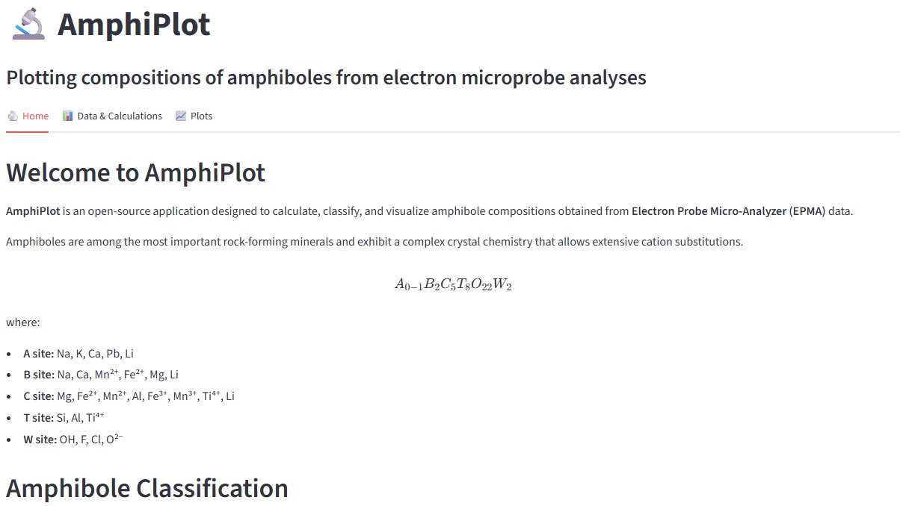
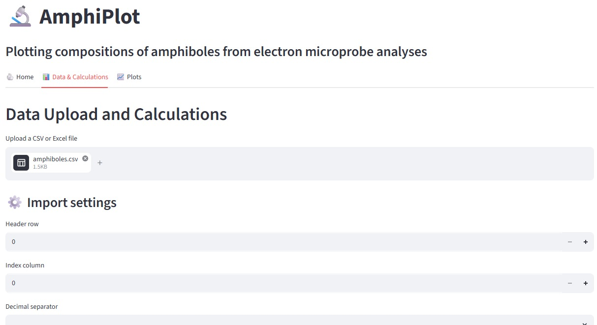
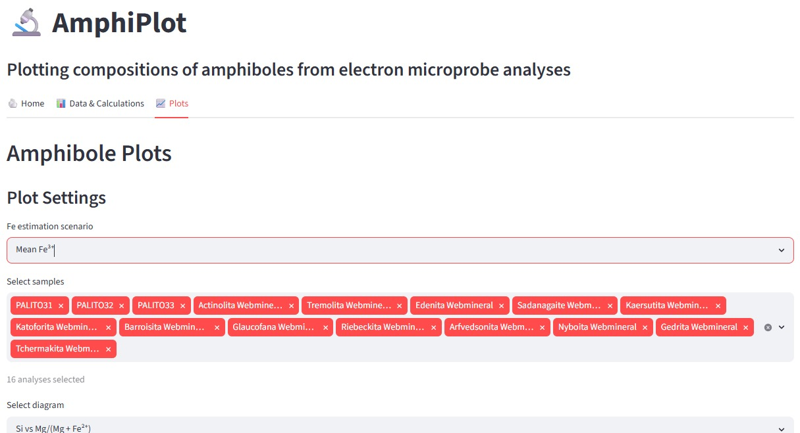
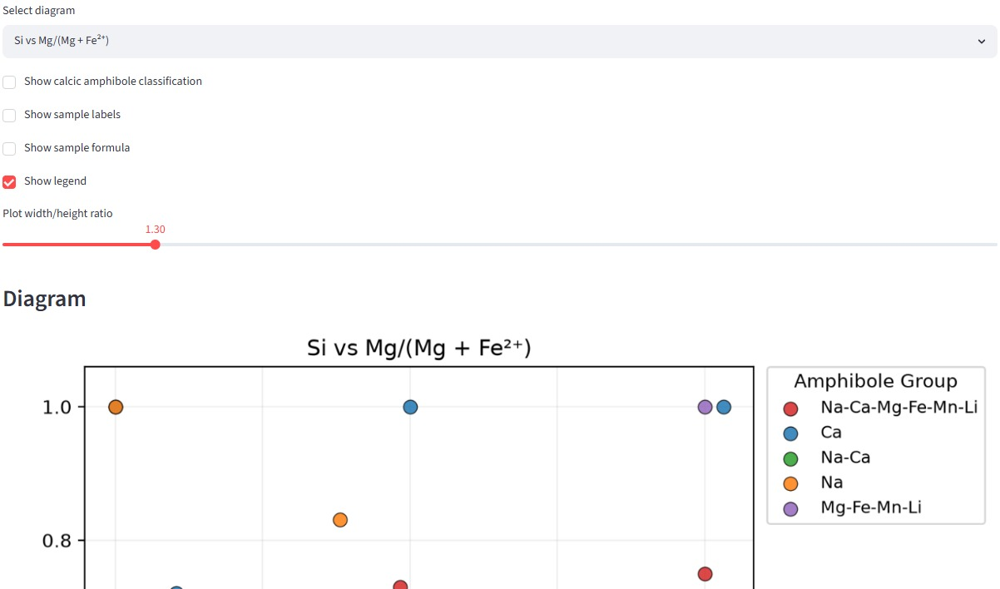

# AmphiPlot

**AmphiPlot** is an open-source [Streamlit](https://streamlit.io/)
application for calculating, classifying, and visualizing amphibole
compositions from **Electron Probe Micro-Analyzer (EPMA)** analyses.

The app provides an interactive workflow from uploading geochemical data
to calculating amphibole structural formulas, inspecting
crystallographic site occupancies, and creating compositional diagrams.

## Application overview

### 1. Home page

The home page introduces amphibole crystal chemistry, the general
structural formula, classification principles, and the expected
input-data format.



*Figure 1. Home page showing the application introduction and amphibole
classification information.*

### 2. Upload EPMA data

Upload a CSV or Excel file containing amphibole analyses. Each row
should represent a sample, with oxide and element concentrations
reported in **weight percent (wt.%)**.



*Figure 2. Data upload interface for importing EPMA analyses.*

### 3. Calculate structural formulas

Run the calculations to obtain amphibole structural formulas, cation
distributions across crystallographic sites, and classification results.
Processed results can be reviewed and exported.


*Figure 3. Calculated amphibole structural formulas and associated
output tables.*

### 4. Configure plots

Select the samples and visualization options to customize the
presentation of geochemical data.



*Figure 4. Plot configuration controls.*

### 5. Configure diagrams

Choose the desired compositional diagram and adjust its display
settings.



*Figure 5. Diagram selection and configuration interface.*

## Main features

-   Structural formula calculations from EPMA oxide analyses
-   Cation normalization and crystallographic site allocation
-   Amphibole group classification based on site occupancy
-   Interactive geochemical diagrams
-   Configurable sample selection and plot settings
-   Export of processed calculation results

## Input data

Input files should contain **one sample per row** and oxide/element
concentrations in **wt.%**. Use the following column names when
providing the corresponding analyses:

``` text
SiO2, TiO2, Al2O3, Fe2O3, FeO, MnO, MgO, CaO, Na2O,
Li2O, K2O, BaO, Cs2O, Rb2O, F, Cl, Sc2O3, Cr2O3,
V2O3, ZnO, NiO, CoO, ZrO2, SrO, Mn2O3
```

**Note:** `F` and `Cl` are elemental concentrations, not oxides. The
uploaded file's sample-identifier format must match the application's
file loader. Consult the Home tab for guidance before uploading.

## Run locally

### 1. Clone the repository

``` bash
git clone https://github.com/YOUR_USERNAME/AmphiPlot.git
cd AmphiPlot
```

Replace `YOUR_USERNAME` with your GitHub username. Access to the
repository is required if it is private.

### 2. Create a Python environment (recommended)

``` bash
python -m venv .venv
```

Activate it:

**Windows (PowerShell)**

``` powershell
.venv\Scripts\Activate.ps1
```

**macOS / Linux**

``` bash
source .venv/bin/activate
```

### 3. Install dependencies

``` bash
pip install -r requirements.txt
```

### 4. Start the application

``` bash
streamlit run main.py
```

Open the local URL printed by Streamlit in your terminal.

## Deploy with Streamlit Community Cloud

The application can be deployed from a GitHub repository using
[Streamlit Community Cloud](https://share.streamlit.io/deploy).

1.  Sign in using GitHub and authorize access to the repository.
2.  Select the repository and branch to deploy.
3.  Set the entry-point file to `main.py`.
4.  Deploy the application.

Ensure that `requirements.txt` lists the third-party Python dependencies
used by the project.

## Scientific reference

Hawthorne, F. C., Oberti, R., Harlow, G. E., Maresch, W. V., Martin, R.
F., Schumacher, J. C., & Welch, M. D. (2012). *Nomenclature of the
amphibole supergroup*. **American Mineralogist**, 97, 2031--2048.
https://doi.org/10.2138/am.2012.4276

## License

AmphiPlot is available for academic, educational, and non-commercial research use only.

Commercial use, including paid consulting, commercial research, and integration into commercial products or services, requires prior written authorization from the copyright holder.

See the LICENSE file for the complete terms.